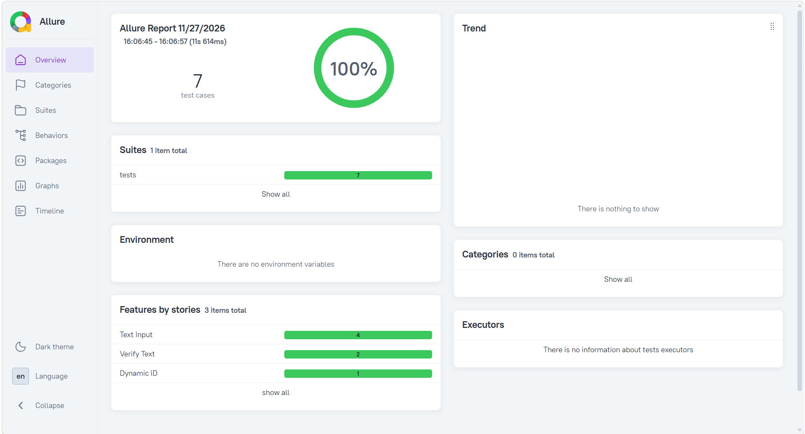

# HW 5 Web UI tests

Автотесты для сайта [UI Test Automation Playground](http://www.uitestingplayground.com/home).
Стек: Python, pytest, Playwright, Allure.

## Что автоматизировано

- Dynamic ID: кнопка находится без id, хотя id меняется при каждой загрузке страницы
- Text Input: ввод текста в поле меняет название кнопки (3 набора данных)
- Verify Text: поиск элемента по тексту через CSS и XPath

## Паттерны

- Page Object: для каждой страницы свой класс в `pages/`, локаторы и действия описаны в нём
- Базовый класс `BasePage` с общими методами (наследование)
- Параметризация тестов (Data Provider)

## Структура

- `config/` - настройки (адрес сайта)
- `pages/` - Page Object классы
- `tests/` - тесты

## Как запустить

```
python -m venv .venv
.venv\Scripts\activate
pip install -r requirements.txt
playwright install chromium
pytest
```

Чтобы видеть браузер: `pytest --headed`.

Отчёт Allure (нужен установленный Allure Commandline):
```
allure serve allure-results
```

## Отчёт


